# Comparação visual e de uso — LAOMAX × LANUC

Data: 12/11/2026. Revisão da abertura, conteúdo, participação e navegação móvel.

## Parecer

A LANUC funciona melhor como referência de leitura, hierarquia e presença institucional. A primeira versão da LAOMAX dá peso excessivo ao nome, ao selo e às frases de efeito, enquanto reduz as informações úteis. A diferença observada não se resolve apenas trocando cores ou completando a diretoria.

O problema de direção da LAOMAX foi combinar títulos finos e muito grandes com navegação, descrições e ações pequenas. A composição tem organização, mas a experiência precisa ser revista a partir da leitura e das tarefas do visitante.

## Escopo e limites

- Referência consultada ao vivo: https://lanuc.com.br/#inicio .
- LAOMAX avaliada na versão local entregue, sem alterações de apresentação nesta revisão.
- O HTML completo da página inicial e as primeiras 12 linhas do CSS foram comparados com os arquivos atuais do repositório https://github.com/GustavoBifulco/laomax e coincidiram. Isso confirma a correspondência dos trechos verificados, não uma igualdade integral de todos os arquivos do repositório.
- O domínio `https://laomax.com.br/`, indicado pelo CNAME no GitHub, retornou `ERR_CERT_COMMON_NAME_INVALID` no navegador da revisão. Não foi ultrapassado o bloqueio de certificado. A renderização pública não foi avaliada.
- Capturas aceitas: computador em 1280 × 720; celular em 390 × 720. As medidas de fonte foram lidas dos estilos aplicados no navegador. Pixels CSS não são uma medição de desempenho real de leitura.
- Esta é uma revisão de experiência e apresentação. Não é uma certificação de acessibilidade. Não foram feitos testes com usuários, leitores de tela ou submissões externas.
- Nenhum arquivo do site, contato, inscrição ou conteúdo remoto foi alterado. Foram acrescentados apenas este relatório e os registros da comparação.

## 1. Abertura no computador — LAOMAX abaixo da referência

| LANUC | LAOMAX |
| --- | --- |
| 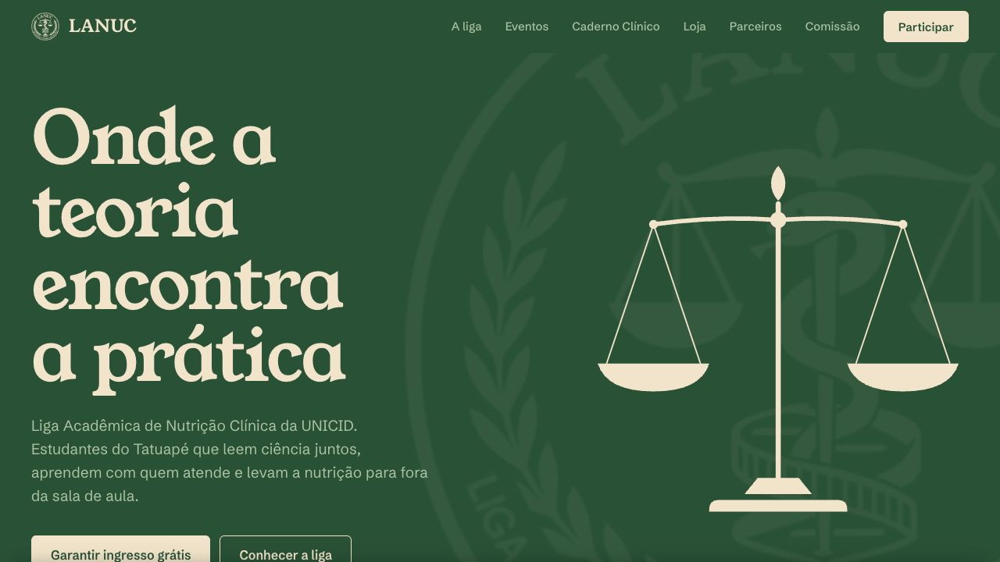 | 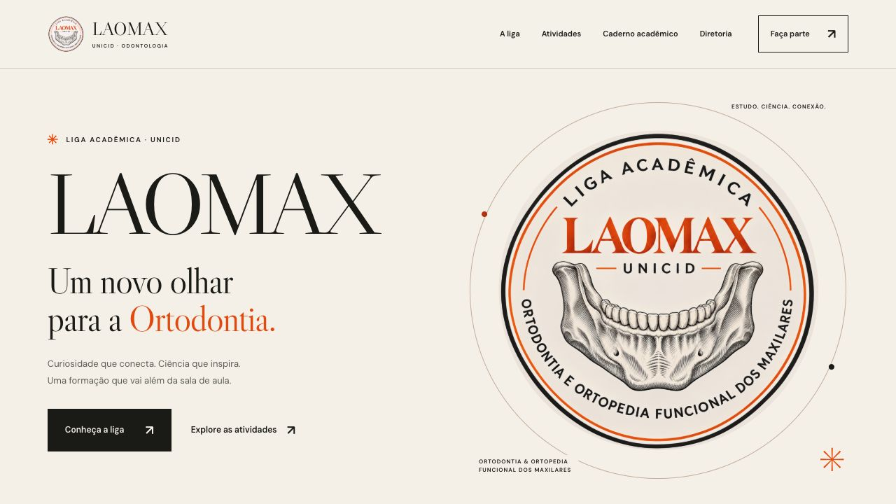 |

**Observado:** a LANUC usa Young Serif no título, com desenho mais encorpado, e um campo de cor verde que integra marca, mensagem e ilustração. A descrição explica o nome da liga, o público e atividades em linguagem direta. A LAOMAX usa Libre Caslon Display, com traços finos, repete a marca em tamanho grande e coloca o selo como segundo elemento dominante. A explicação da liga é substituída na abertura por frases genéricas.

| Elemento | LANUC | LAOMAX |
| --- | --- | --- |
| Descrição de abertura | 19,2 px | 13 px |
| Menu principal | 15 px | 11 px |
| Título principal | Mensagem: 94,72 px | Nome: 122,88 px; mensagem: 51,84 px |
| Ilustração de marca da LAOMAX | — | Imagem do selo: aproximadamente 476 × 476 px |

**Impacto:** a LAOMAX permite reconhecer a marca rapidamente, mas exige mais atenção para ler o que ela oferece. A diferença entre o tamanho da marca e a escala da informação é excessiva.

**Correção proposta:** dar prioridade à mensagem e à explicação da liga; aumentar o corpo de abertura para aproximadamente 18–20 px; elevar navegação e ações para uma faixa de 14–16 px; usar títulos com mais espessura; reduzir a competição entre selo, nome e texto. Essas são metas de projeto a verificar visualmente, não uma regra universal de acessibilidade.

## 2. Leitura ao rolar a página — LAOMAX excessivamente abstrata

| LANUC | LAOMAX |
| --- | --- |
| 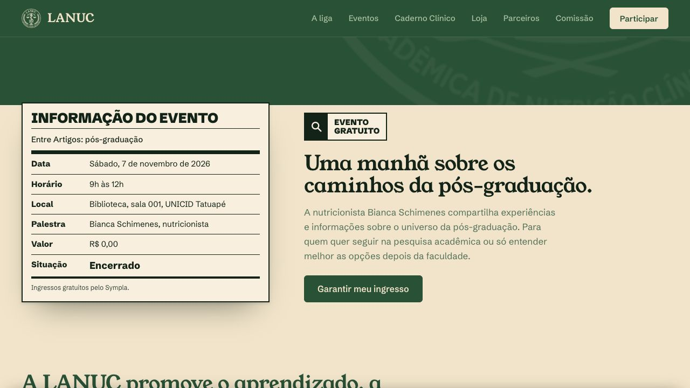 | 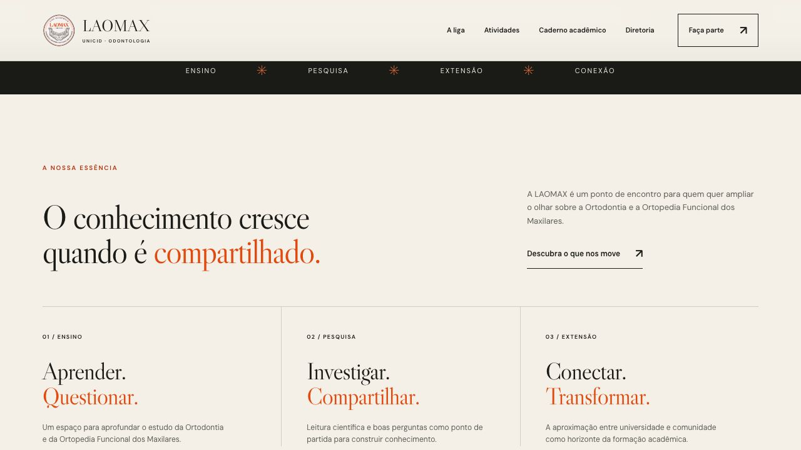 |

**Observado:** na posição capturada, a LANUC apresenta um encontro com data, horário, local, palestrante, valor e situação. A descrição tem 17 px. A LAOMAX mostra um manifesto e três pilares, cujas descrições têm 12 px, com grandes áreas de fundo e títulos entre elas.

**Impacto:** a LANUC oferece informação concreta; a LAOMAX comunica intenção. A falta de dados oficiais limita o conteúdo disponível, mas o tamanho dos textos e a repetição de frases de efeito são escolhas de apresentação que podem ser corrigidas imediatamente.

**Correção proposta:** encurtar o manifesto e apresentar com clareza o que já se sabe da liga; colocar o canal oficial e as ações disponíveis em posição melhor; reservar espaço proporcional para os encontros reais quando forem informados. Não preencher com eventos, cargos, fotos ou estatísticas inventados.

## 3. Caderno — funcional, com apresentação pouco orientada à consulta

| LANUC | LAOMAX |
| --- | --- |
| 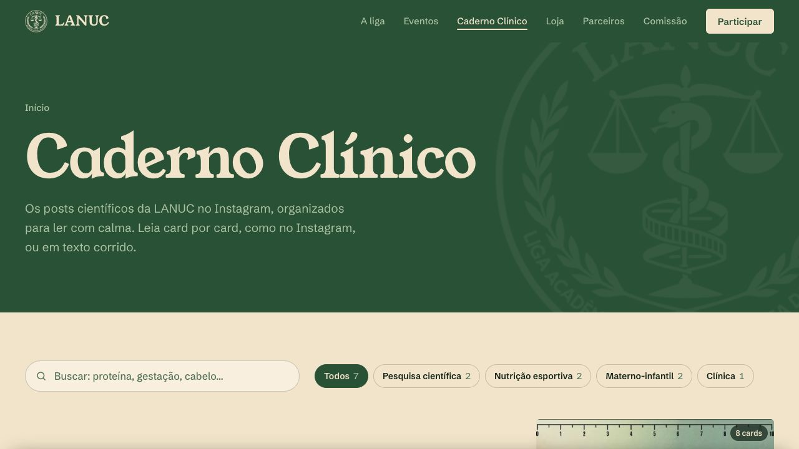 | 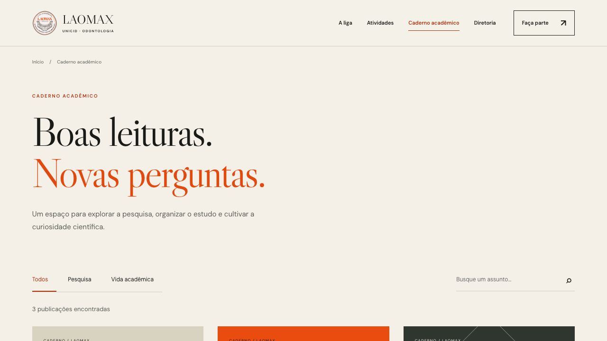 |

**Observado:** a LANUC chama a seção de Caderno Clínico, explica a origem das publicações e mostra busca com exemplos de assuntos. Categorias têm contagem e aparência clara de controles. A LAOMAX prioriza “Boas leituras. Novas perguntas.”, mantém a busca à direita com texto de 12 px e categorias discretas. A busca da referência usa texto de 16 px.

**Impacto:** a busca da LAOMAX parece secundária. O visitante precisa interpretar uma frase de campanha antes de se orientar numa biblioteca de conteúdo.

**Ressalva:** as duas páginas usam aberturas altas; na captura, os conteúdos começam perto da parte inferior da tela. Não se concluiu que a referência resolve perfeitamente o uso do espaço.

**Correção proposta:** usar “Caderno acadêmico” como título funcional principal, tornar busca e categorias mais visíveis, aumentar controles e resumos e criar capas que ajudem a reconhecer o assunto. Manter rascunhos e revisão editorial pendente claramente separados do conteúdo aprovado para publicação.

## 4. Participação — LAOMAX demora a oferecer o próximo passo

| LANUC | LAOMAX |
| --- | --- |
| 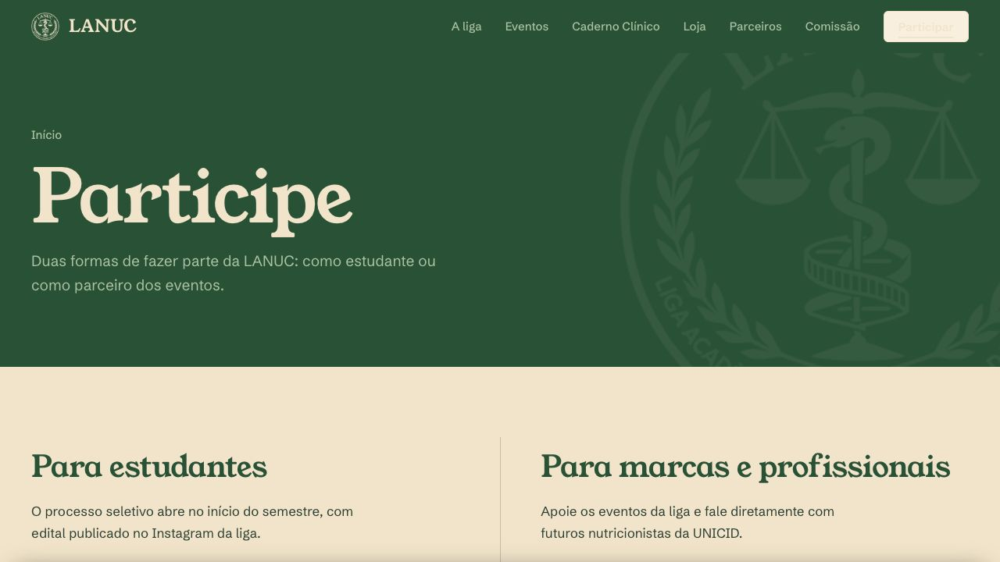 | 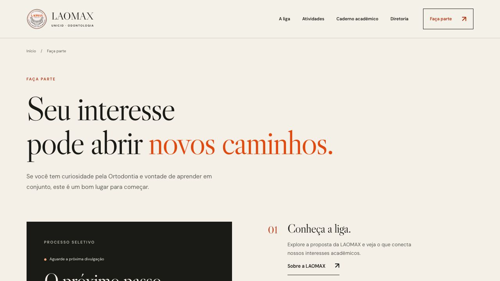 |

**Observado:** a LANUC apresenta duas formas de participar: estudante ou parceiro. A LAOMAX abre com uma frase longa e grande, mostra seleção aguardando divulgação e oferece links para voltar a outras páginas. O Instagram existe mais abaixo na página.

**Impacto:** um visitante interessado ainda não sabe rapidamente o que pode fazer hoje. A ausência de seleção aberta não exige uma página longa com vários retornos à apresentação.

**Correção proposta:** colocar a situação atual da seleção em poucas linhas e aproximar o botão do Instagram. Organizar caminhos claros para estudantes e para propostas de colaboração, usando somente os contatos e condições confirmados da LAOMAX.

## 5. Abertura no celular — diferença importante de escala

| LANUC | LAOMAX |
| --- | --- |
| 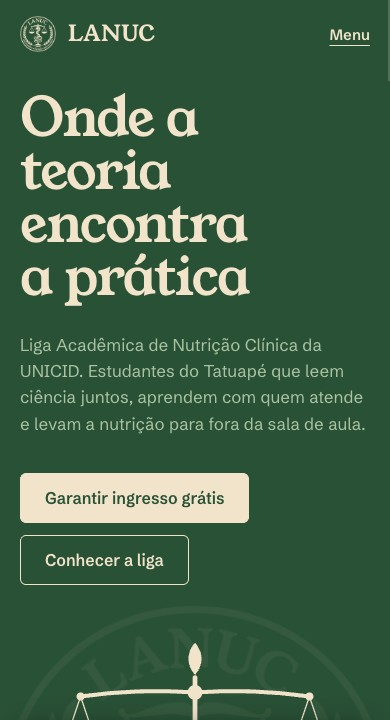 | 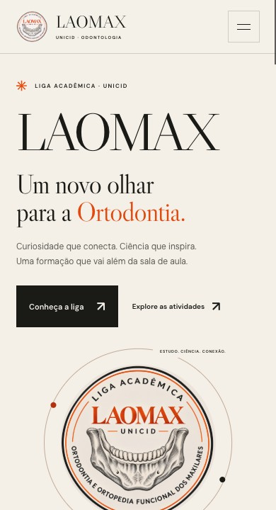 |

| Elemento em 390 px de largura | LANUC | LAOMAX |
| --- | --- | --- |
| Descrição | 17 px | 12 px |
| Texto da ação principal | 16 px | 11 px |
| Texto da ação secundária | 16 px | 10 px |
| Hierarquia do título | Mensagem: 54 px | Nome: 74,1 px; mensagem: 38 px |

**Observado:** as duas páginas se reorganizam para a largura e não apresentaram excesso de largura nessa medição. A LAOMAX mantém um selo grande depois das ações; a leitura do texto e dos links fica muito menor do que a marca. O segundo link tem aproximadamente 31 px de altura, enquanto os dois botões da referência têm 50 px.

**Impacto:** adaptar a largura não basta para oferecer uma boa experiência móvel. O texto da LAOMAX exige mais esforço e a ação secundária tem pouca presença.

**Correção proposta:** corpo de aproximadamente 16–18 px, ações com texto de 14–16 px e áreas de toque confortáveis; hierarquia que valorize a explicação e a participação antes da repetição da marca. A nova escala precisa ser validada em aparelhos reais e com ampliação de texto.

## 6. Menu móvel — funciona, mas a referência orienta melhor

| LANUC | LAOMAX |
| --- | --- |
| 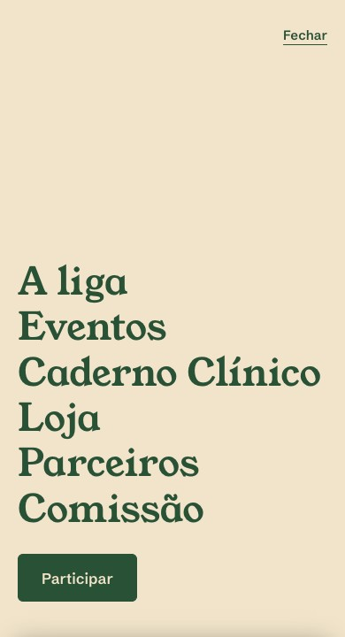 | 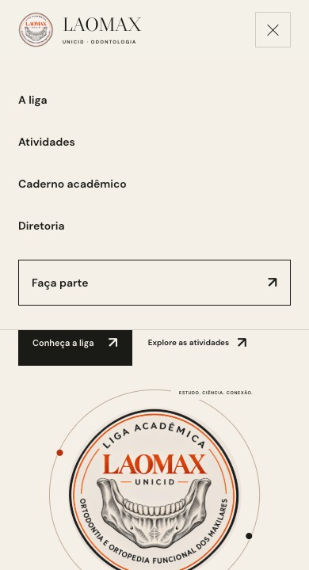 |

**Observado:** a LANUC dedica a tela à navegação e apresenta opções grandes e um comando “Fechar”. A LAOMAX abre uma lista menor sobre o conteúdo, deixando ações e parte do selo visíveis ao fundo. A abertura e o fechamento funcionaram nos dois casos.

**Impacto:** o menu da LAOMAX é utilizável, mas oferece menos foco e presença visual. A opção de tela inteira da referência é uma solução possível, não uma exigência para todo site.

**Correção proposta:** aumentar opções e espaçamento; dar um estado mais claro à navegação aberta; avaliar um painel completo com “Menu” e “Fechar” escritos, preservando as funções de teclado existentes.

## O que preservar na LAOMAX

- O selo original e a identificação correta da liga.
- O laranja e o preto como base da identidade.
- O canal oficial @laomax_unicid.
- A navegação consistente e a estrutura de conteúdo editável.
- Os mecanismos já existentes de busca, filtro e perguntas frequentes.
- O cuidado de não inventar nomes, eventos e inscrições.

Esses pontos são uma base de trabalho; não justificam manter a escala e a hierarquia atuais.

## O que não copiar da referência

A LANUC também apresenta oportunidades de correção. Na abertura de 1280 × 720, os botões ficam parcialmente abaixo da primeira tela. O encontro de 7/11/2026 está marcado como encerrado, mas ainda aparecem chamadas para garantir ingresso. A referência deve orientar leitura e organização, sem reproduzir esses estados contraditórios.

## Ordem recomendada de correção

1. Refazer a escala de textos, controles e botões, começando por descrições e navegação.
2. Escolher uma tipografia de títulos com traço mais encorpado e validar seu uso ao lado do selo.
3. Reorganizar a abertura: mensagem clara, explicação da LAOMAX e ação útil, com marca em proporção adequada.
4. Simplificar o texto das páginas internas e trazer busca, agenda e participação para o primeiro plano.
5. Reforçar a identidade cromática e separar visualmente os blocos com propósito, sem depender de grandes áreas vazias.
6. Incorporar gradualmente conteúdo institucional e registros reais, após confirmação.
7. Rever o menu móvel e testar leitura e toques em aparelho real.
8. Tratar o certificado do domínio antes de avaliar ou anunciar a experiência pública como operacional.

As primeiras correções dependem de projeto e implementação, não de novos dados da diretoria. O próximo passo recomendado é uma revisão estrutural da apresentação com essas prioridades, preservando a identidade da LAOMAX.

## Registros

Capturas e medidas desta revisão: `output/auditoria-2026-11-12/`. As imagens antigas da entrega não foram usadas como evidência para este diagnóstico.
